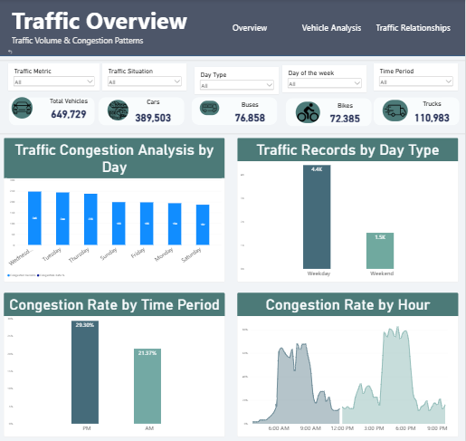
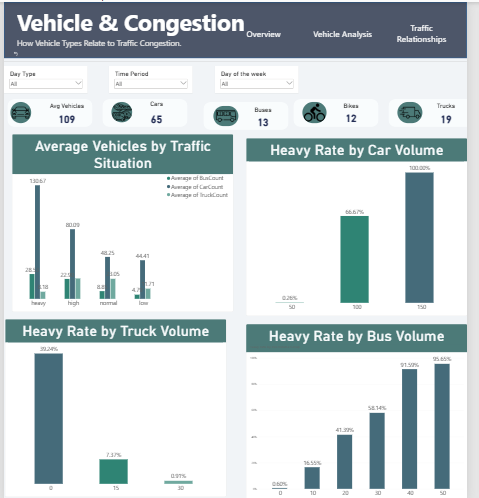
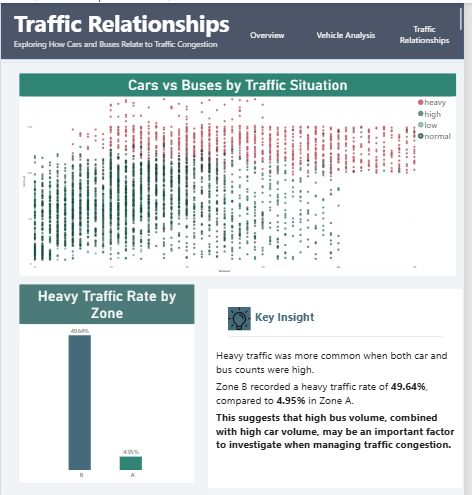
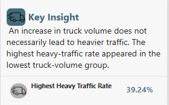
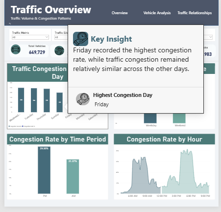

# traffic-data-analysis
Traffic data analysis project using Python to explore congestion patterns, peak hours, busiest days, and vehicle distribution.

# تحليل بيانات المرور

## نظرة عامة على المشروع

يهدف هذا المشروع إلى تحليل بيانات المرور باستخدام Python لاكتشاف أنماط الحركة المرورية، وتحديد ساعات الذروة، وأكثر الأيام ازدحامًا، وأكثر أنواع المركبات استخدامًا، ومستويات الازدحام المختلفة.

## أهداف المشروع

* تحديد أكثر ساعات اليوم ازدحامًا.
* تحليل ساعات الذروة المرورية.
* معرفة أكثر أيام الأسبوع ازدحامًا.
* تحليل أنواع المركبات المختلفة.
* معرفة أكثر حالات المرور تكرارًا.
* تحليل الازدحام الشديد حسب الساعة.
* دراسة المركبات الأكثر مساهمة أثناء الازدحام الشديد.
* مقارنة المرور بين أيام العمل وعطلة نهاية الأسبوع.

## الأدوات المستخدمة

* Python
* Pandas
* Matplotlib
* Jupyter Notebook

---

## 1. ما أكثر ساعة ازدحامًا؟

يوضح هذا التحليل متوسط عدد المركبات حسب الساعة لتحديد أكثر ساعات اليوم ازدحامًا.

---

## 2. تحليل ساعات الذروة المرورية

يوضح الرسم التغير في الحركة المرورية خلال ساعات اليوم، حيث تظهر ذروة صباحية بين 6 صباحًا و8 صباحًا، وذروة مسائية أعلى بين 4 مساءً و6 مساءً.

---

## 3. ما أكثر يوم ازدحامًا؟

يبين الرسم أن يوم السبت سجل أعلى متوسط للحركة المرورية، بينما كان يوم الأحد الأقل ازدحامًا.

---

## 4. ما أكثر أنواع المركبات استخدامًا وقت الزحام؟

تمثل السيارات العدد الأكبر بفارق واضح مقارنة ببقية المركبات، مما يدل على الاعتماد الكبير على المركبات الخاصة.

---

## 5. أي نوع مركبة يكون أعلى في أيام الأسبوع؟

يوضح الرسم متوسط أعداد المركبات خلال أيام الأسبوع، مع استمرار السيارات كأعلى نوع يوميًا.

---

## 6. ما أكثر حالات المرور تكرارًا؟

تعد حالة المرور الطبيعية normal الأكثر تكرارًا، بينما تظهر الحالات الأخرى بنسبة أقل.

---

## 7. ما أكثر الساعات التي يحدث فيها ازدحام مروري شديد؟

يتركز الازدحام الشديد خلال فترات الذروة الصباحية والمسائية، خصوصًا بين 4 مساءً و6 مساءً.

---

## 8. ما أنواع المركبات الأكثر مساهمة في الازدحام المروري الشديد؟

تشير النتائج إلى أن السيارات هي المساهم الأكبر في حالات الازدحام الشديد مقارنة ببقية المركبات.

---

## 9. ما العلاقة بين عدد المركبات وحالة المرور؟

كلما ارتفعت حالة المرور من منخفض إلى شديد، ازداد متوسط عدد المركبات بشكل واضح.

---

## 10. هل أيام العمل أكثر ازدحامًا من نهاية الأسبوع؟

لا يظهر فرق كبير في متوسط الحركة المرورية بين أيام العمل وعطلة نهاية الأسبوع.

---

## أبرز النتائج

* أعلى ازدحام مروري بين 4 مساءً و6 مساءً.
* توجد ذروة صباحية بين 6 صباحًا و8 صباحًا.
* يوم السبت الأعلى حركة مرورية.
* يوم الأحد الأقل ازدحامًا.
* السيارات هي النوع الأكثر استخدامًا.
* الحالة الطبيعية normal هي الأكثر تكرارًا.
* لا يوجد فرق كبير بين أيام العمل وعطلة نهاية الأسبوع.

---

## المرحلة الثانية: تطوير لوحة تفاعلية باستخدام Power BI

بعد مرحلة التحليل الاستكشافي باستخدام Python، تم تطوير لوحة معلومات تفاعلية في **Microsoft Power BI** لعرض مؤشرات المرور، وتحليل أنماط الازدحام، واستكشاف العلاقة بين أعداد المركبات وحالات المرور.

### الأدوات والمهارات المستخدمة في Power BI

* Power BI Desktop
* Power Query
* DAX Measures
* Data Visualization
* Interactive Slicers
* Report Page Tooltips
* Clear All Slicers Button

### صفحات التقرير

#### 1. Traffic Overview

تعرض نظرة شاملة على حركة المرور تشمل إجمالي المركبات بحسب النوع، ومقارنة مؤشرات الازدحام عبر أيام الأسبوع، وبين الفترتين الصباحية والمسائية، وحسب الساعة. وتتيح الفلاتر استكشاف النتائج بحسب الفترة واليوم وحالة المرور.

#### 2. Vehicle & Congestion

تقارن متوسط أعداد المركبات عبر حالات المرور المختلفة، وتعرض **Heavy Traffic Rate** بحسب مجموعات أعداد السيارات والحافلات والشاحنات. يساعد ذلك على استكشاف الأنماط المرتبطة بحالات الازدحام الشديد لكل نوع مركبة.

#### 3. Traffic Relationships

تستخدم مخططًا مبعثرًا (Scatter Plot) لمقارنة أعداد السيارات والحافلات بحسب حالة المرور، ثم تقارن معدل الازدحام الشديد بين مجموعات مبنية على أعداد السيارات والحافلات مقارنةً بالوسيط (Median).

في التقسيم المستخدم، بلغت نسبة سجلات `Heavy` في **Zone B** (أعداد سيارات وحافلات أعلى من الوسيط) **49.64%**، مقابل **4.95%** في **Zone A** (سيارات أعلى من الوسيط وحافلات أقل منه أو مساوية له). تشير المقارنة إلى ارتباط في البيانات، ولا تثبت وجود علاقة سببية.

### صور تقرير Power BI

---

## الملفات

* Traffic.csv
* Untitled-1.ipynb
* README.md
* 1.png – 5.png (Power BI dashboard screenshots)

---

## الكاتب

Hanan Aljaber
