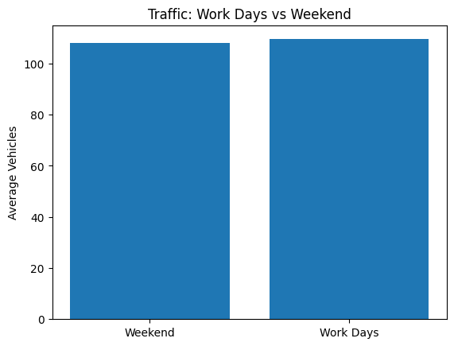
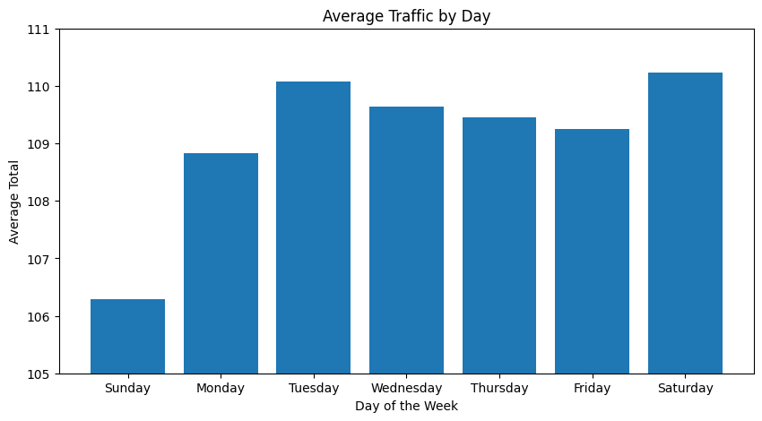
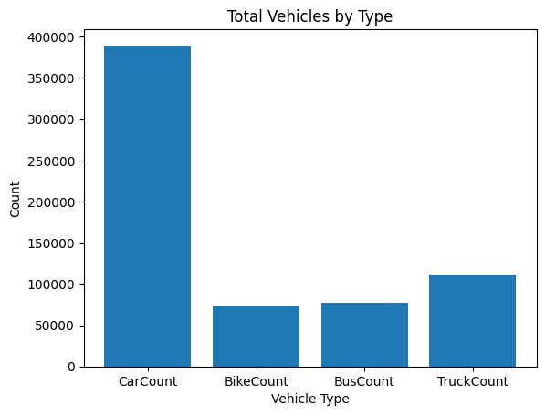
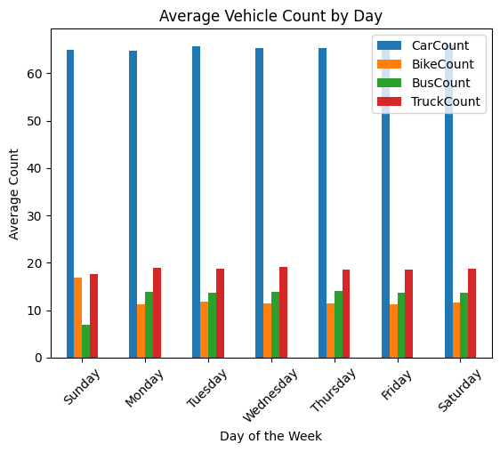
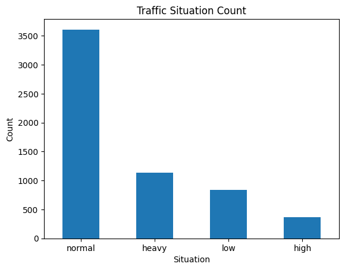
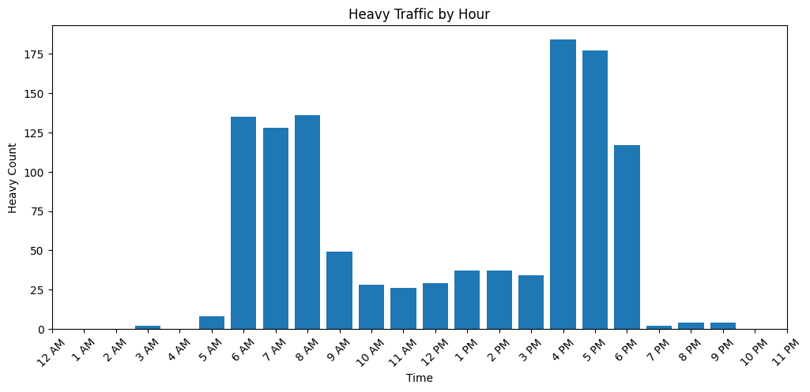
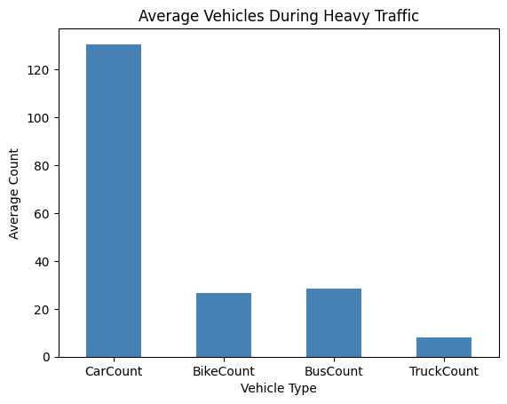
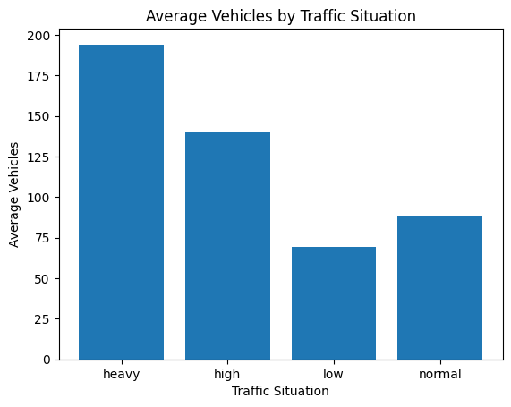

# Traffic Data Analysis | تحليل بيانات المرور

**Exploratory Data Analysis with Python & Interactive Dashboards with Power BI**

مشروع لتحليل أنماط حركة المرور، وساعات الذروة، واختلاف حجم حركة المركبات حسب الأيام والفترات، واستكشاف العلاقة بين أنواع المركبات وحالات المرور باستخدام **Python** ثم تطوير لوحات معلومات تفاعلية باستخدام **Power BI**.

> **ملاحظة منهجية:** تحليل Python وتحليل Power BI مرحلتان من المشروع نفسه. المقارنة بين نتائجهما تتطلب استخدام المؤشر نفسه، وطريقة التجميع نفسها، والفلاتر نفسها. اختلاف أعلى يوم بحسب **متوسط حجم الحركة** عن أعلى يوم بحسب **نسبة الازدحام الشديد** لا يُعد تناقضًا بحد ذاته.

---

## أهداف المشروع

- فهم توزيع الحركة المرورية عبر ساعات اليوم وأيام الأسبوع.
- تحديد ساعات الذروة الصباحية والمسائية.
- مقارنة متوسط الحركة المرورية بين الأيام وأيام العمل وعطلة نهاية الأسبوع.
- دراسة توزيع أنواع المركبات وأعدادها.
- تحليل تكرار حالات المرور، بما فيها `Heavy` و`Normal`.
- استكشاف العلاقة بين عدد المركبات ومستويات الازدحام.
- تطوير تجربة تحليل تفاعلية تعرض مؤشرات رئيسية (KPIs) وتفاصيل إضافية عند التفاعل مع الرسومات.

## الأدوات المستخدمة

**Python analysis:** Python · Pandas · Matplotlib · Jupyter Notebook  
**Interactive reporting:** Microsoft Power BI · Power Query · DAX · Slicers · Report-page Tooltips

## مصدر البيانات

البيانات المستخدمة في المشروع موجودة في [`Traffic.csv`](Traffic.csv). للاطلاع على خطوات التحليل البرمجي: [`Untitled-1.ipynb`](Untitled-1.ipynb).

---

## المرحلة الأولى: الاستكشاف باستخدام Python

### 1. متوسط حجم الحركة حسب اليوم

يعرض الرسم متوسط الحركة المرورية بحسب يوم الأسبوع. في التحليل الاستكشافي السابق ظهر **السبت** باعتباره اليوم الأعلى من حيث *متوسط حجم الحركة المرورية*، وليس بالضرورة الأعلى في *نسبة حالات الازدحام الشديد*.

### 2. ساعات الذروة المرورية

يستعرض تغير الحركة المرورية خلال ساعات اليوم؛ ويشير التحليل السابق إلى نشاط صباحي بين **6–8 صباحًا** ونشاط مسائي أعلى تقريبًا بين **4–6 مساءً**.

### 3. الساعة الأعلى حركة مرورية

مقارنة متوسط حجم الحركة حسب الساعة لتحديد الفترات الأعلى من حيث عدد المركبات المسجل في البيانات.

### 4. توزيع المركبات حسب النوع

تقارن هذه الصورة إجمالي أعداد المركبات المسجلة حسب نوع المركبة، وتظهر السيارات العدد الأكبر في العينة.

### 5. متوسط أعداد المركبات حسب اليوم والنوع

توضح المقارنة الاختلاف اليومي في متوسط أعداد المركبات لكل نوع.

### 6. توزيع حالات المرور

توضح النتائج تكرار كل فئة من حالات المرور؛ وتظهر فئة `Normal` بوصفها الأكثر تكرارًا في الرسم.

### 7. حالات الازدحام الشديد حسب الساعة

يعرض الرسم توزيع السجلات المصنّفة `Heavy` على ساعات اليوم بهدف التعرف على توقيت تكرار هذه الحالات.

### 8. أنواع المركبات أثناء الازدحام الشديد

توضح الصورة متوسط أعداد المركبات حسب النوع ضمن السجلات المصنّفة `Heavy`. ارتفاع عدد السيارات لا يثبت وحده أنها **تسبب** الازدحام؛ بل يشير إلى حضورها العددي الأكبر في هذه السجلات.

### 9. متوسط أعداد المركبات حسب حالة المرور

مقارنة وصفية بين متوسط أعداد المركبات وفئات حالة المرور، تساعد على فحص العلاقة بين كثافة المركبات ومستوى الحركة.

### 10. أيام العمل مقارنة بعطلة نهاية الأسبوع

تُناقش هذه المقارنة اختلاف الحركة بين فئتي `Weekday` و`Weekend`. **قبل استخدام الرسم كدليل على هذا الاستنتاج، يجب التحقق من رابط الصورة والمقياس المعروض**؛ لأن الصورة `output9.png` مرتبطة أيضًا برسم متوسط الحركة حسب اليوم أعلاه.

<!-- بعد تحديد الصورة الصحيحة لهذا التحليل، أزيلي التعليق التالي وعدلي الاسم:

-->

---

## المرحلة الثانية: تطوير التقرير باستخدام Power BI

بعد التحليل الاستكشافي، توسّع المشروع إلى تقرير تفاعلي يتيح الانتقال من المؤشرات العامة إلى المقارنات التفصيلية. وتشمل التحسينات:

- مؤشرات الأداء الرئيسية (KPIs) لملخص المرور.
- مقارنة أنماط الازدحام حسب اليوم والساعة والفترة الزمنية.
- تحليل أنواع المركبات وعلاقتها بتصنيفات الحركة.
- فلاتر تفاعلية لاختيار أجزاء محددة من البيانات.
- صفحات **Report-page Tooltips** لتقديم استنتاجات موجزة بجانب الرسومات.
- زر **Reset Filters** لمسح اختيارات الـSlicers.

### صور التقرير التفاعلي

الصور التالية مرفوعة في المجلد الرئيسي للمستودع. عُرضت بترتيب أسمائها الحالي؛ ويمكن تعديل العناوين بعد تثبيت الترتيب النهائي للصفحات.

#### Dashboard Screenshot 1

#### Dashboard Screenshot 2

#### Dashboard Screenshot 3

#### Dashboard Screenshot 4

#### Dashboard Screenshot 5

### كيف نفهم اختلاف النتائج بين Python وPower BI؟

في تحليل Python، نتيجة «السبت الأعلى» تصف **متوسط حجم الحركة المرورية حسب اليوم**. أما نتيجة «الجمعة الأعلى» التي ظهرت في أحد رسوم Power BI فقد كانت مرتبطة بمؤشر **نسبة الازدحام**؛ ولا يمكن اعتماد هذه المقارنة نهائيًا قبل التحقق من إعدادات `Traffic Metric` وصيغة المقياس والفلاتر المستخدمة.

للمقارنة العادلة يجب توحيد:

1. **المقياس:** متوسط أعداد المركبات أم عدد سجلات `Heavy` أم نسبتها؟
2. **المقام:** عند حساب نسبة `Heavy`، هل نقسم على إجمالي سجلات اليوم نفسه؟
3. **نطاق البيانات:** هل يستعمل البرنامجان الملف نفسه وبعد التنظيف نفسه؟
4. **الفلاتر:** هل طُبقت فلاتر على الأيام أو الفترات أو تصنيف الحركة؟

لذلك لا يُعرض الاختلاف حاليًا على أنه خطأ مؤكّد في أيٍّ من التحليلين؛ بل **مقارنة تتطلب توحيد التعريفات والتحقق**.

---

## أبرز الملاحظات

- أظهر التحليل الاستكشافي فترتي نشاط صباحية ومسائية، مع بروز الفترة المسائية في الرسوم السابقة.
- أظهر تحليل Python أن **السبت أعلى متوسط حركة مرورية** وفق مقياس الرسم المستخدم.
- السيارات هي الفئة الأكبر عددًا في توزيع المركبات المعروض.
- حالة `Normal` هي الأكثر تكرارًا ضمن تصنيفات المرور في التحليل السابق.
- وفر Power BI تحليلًا تفاعليًا أوسع؛ لكن تفسير أي ترتيب للأيام يتوقف على **نوع المؤشر** المختار.

> **حدود التحليل:** العلاقات الظاهرة في الرسوم وصفية ولا تثبت السببية. بعض الاستنتاجات تحتاج مطابقة نهائية مع الحسابات، خصوصًا مقارنة الأيام وأيام العمل مع العطلات.

## ملفات المشروع

| الملف | الوصف |
|---|---|
| [`Traffic.csv`](Traffic.csv) | مجموعة بيانات المرور |
| [`Untitled-1.ipynb`](Untitled-1.ipynb) | التحليل الاستكشافي باستخدام Python |
| `output*.png` | رسوم التحليل الاستكشافي |
| `1.png` – `5.png` | صور تقرير Power BI |
| [`README.md`](README.md) | توثيق المشروع |

## Author

**Hanan Aljaber**  
[GitHub Profile](https://github.com/HananAljaber)
